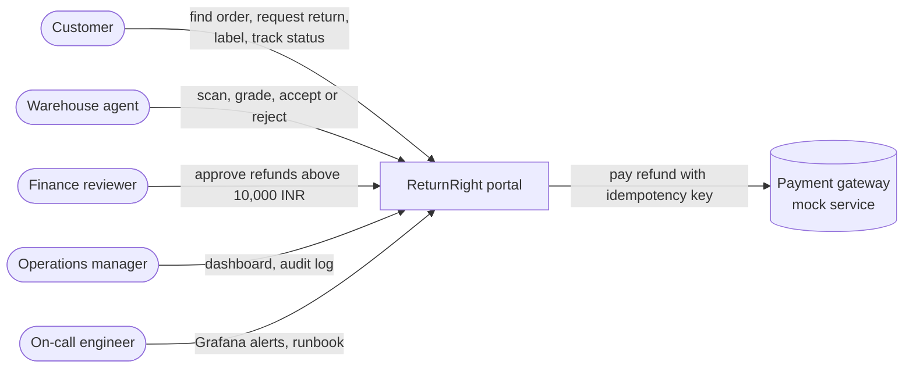
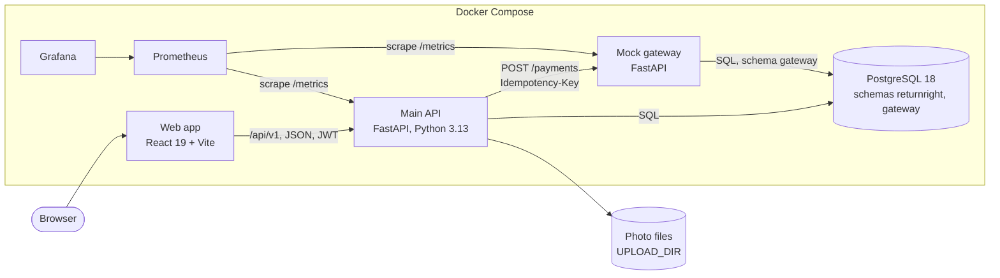
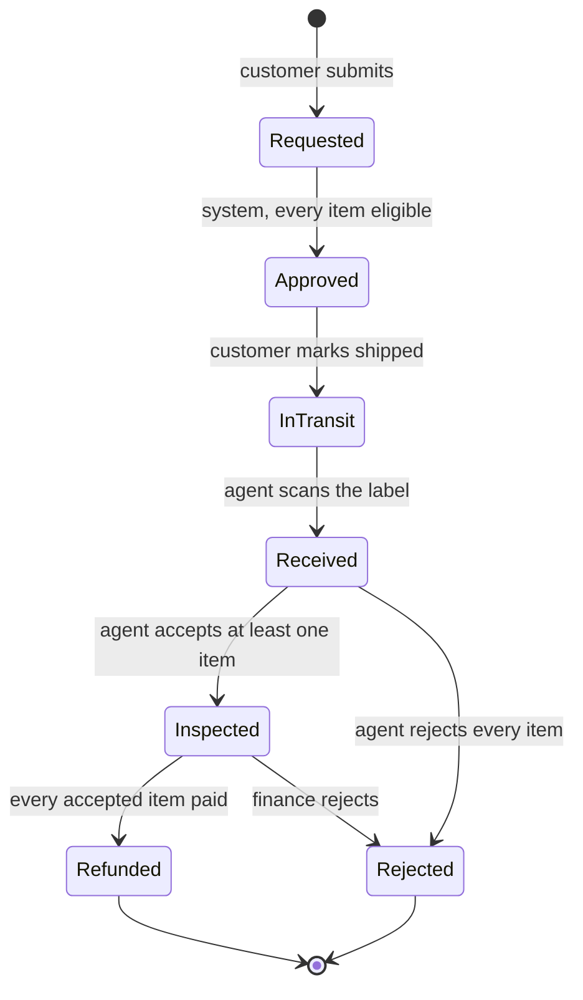
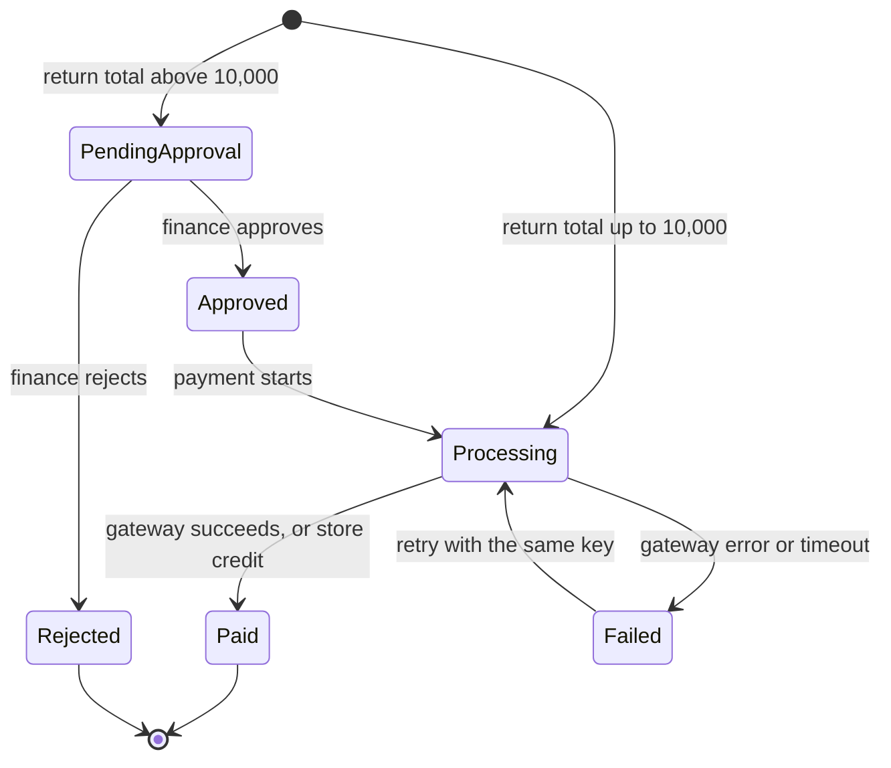
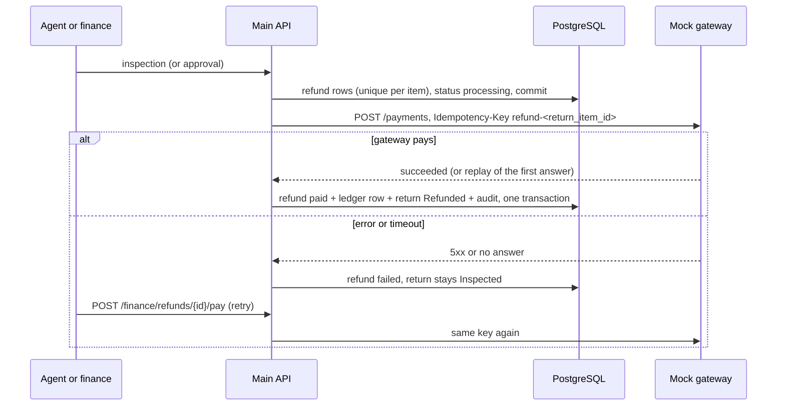

# ReturnRight low-level design

Covers the architecture deliverables from the use case: context and container diagrams, the return state machine, the ledger design and the refund flow. The idempotency decision is [ADR-001](adr/0001-refund-idempotency.md). Tables are in [db/schema_v2.sql](../db/schema_v2.sql) and the API in [api-plan.md](api-plan.md).

## 1. Context

## 2. Containers

| Container | Owner | Responsibility |
| --- | --- | --- |
| Web app | FE | Customer wizard, label, timeline; agent, finance and manager screens |
| Main API | BE-1, BE-2 | Business rules, state machine, refunds, audit, dashboard data |
| Mock gateway | BE-2 | Pays refunds once per key; fault switches for drills |
| PostgreSQL | BE-1 | All data; constraints that enforce the money rules |
| Prometheus and Grafana | BE-2, QA | Refund success rate, gateway latency, alerts |

### Inside the API

| Layer | Folder | Rule |
| --- | --- | --- |
| Endpoints | `api/v1/endpoints` | HTTP only: validate DTOs, check roles, call one service |
| Services | `services` | Use cases and transaction boundaries; write the audit row with every status change |
| Domain | `domain` | Pure rules with no I/O: eligibility, state machine, refund policy, flags |
| Repositories | `repositories` | SQL only |
| Integrations | `integrations` | The gateway client (timeouts, retries with the same key) |

## 3. Return state machine

- Any other move answers 409 "invalid transition" and changes nothing.
- Every move writes one `audit_log` row in the same transaction: who, from, to, when.
- A refund above 10,000 INR (return total) keeps the return Inspected with `awaiting_finance = true` until finance decides.
- Two agents inspecting at once: the `returns.version` column makes the second update fail (409), and `inspections.return_item_id` is unique.

### Refund states

## 4. Refund flow

## 5. Ledger design

| Rule | How |
| --- | --- |
| Insert-only | A trigger blocks UPDATE and DELETE on `ledger_entries` |
| One refund row per refund | `UNIQUE (refund_id, entry_type)` |
| Corrections | A `REVERSAL` row with a negative amount; the original row stays |
| Store credit | Recorded with method `STORE_CREDIT` and no gateway reference |
| Reconciliation | View `v_ledger_check` lists paid refunds whose ledger total differs; it must be empty |

## 6. Failure modes

| Failure | Behaviour | Guard |
| --- | --- | --- |
| Submit clicked twice | One return; the second call gets 409 | Unique index on eligible return items |
| Label scanned twice | "Already received", nothing changes | State machine |
| Two agents inspect at once | One wins, the other gets 409 | Version column, unique inspection per item |
| Refund clicked twice or retried | Paid once | Unique refund per item, gateway key |
| Gateway error | Refund `failed`, retry pays once | Same key on retry |
| Gateway timeout after taking the money | The retry gets the replayed answer | Gateway stores keys |
| Finance approves twice | One decision | Unique `finance_approvals.return_id` |
| Jump from Requested to Refunded | 409 invalid transition | State machine |
| Database down | `/health/ready` answers 503, alert fires | Readiness check |
